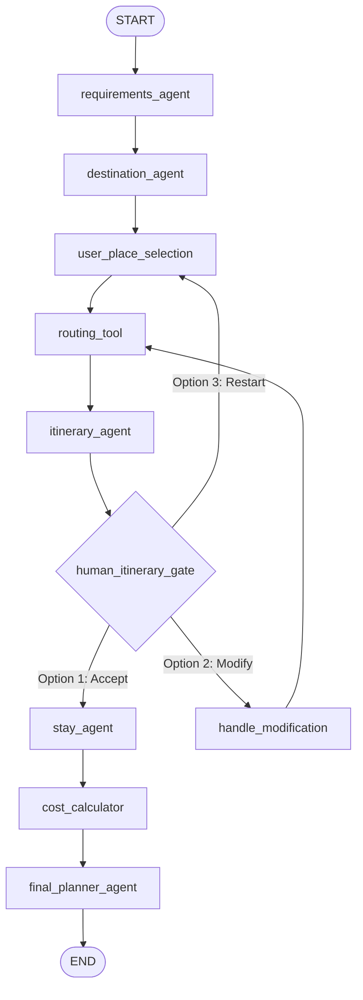

# Open-Source Multi-Agent AI Travel Planner

> An enterprise-grade, 100% open-source multi-agent travel orchestration engine built with **Python**, **LangGraph**, **Ollama (local LLM)**, **OpenStreetMap Nominatim**, **OSRM (Open Source Routing Machine)**, and **FastAPI**.

---

## Table of Contents

1. [Project Overview & Core Philosophy](#1-project-overview--core-philosophy)
2. [Functional Architecture (User Journey)](#2-functional-architecture-user-journey)
3. [Technical Architecture & State Machine](#3-technical-architecture--state-machine)
4. [Agent & Tool Specifications](#4-agent--tool-specifications)
5. [Anti-Hallucination Guardrails](#5-anti-hallucination-guardrails)
6. [Project Structure](#6-project-structure)
7. [REST API Specification](#7-rest-api-specification)
8. [Installation & Setup Guide](#8-installation--setup-guide)
9. [How to Run (CLI & Web UI)](#9-how-to-run-cli--web-ui)
10. [Troubleshooting & FAQ](#10-troubleshooting--faq)

---

## 1. Project Overview & Core Philosophy

Traditional travel planners suffer from two extremes:

1. **Rigid Search Engines**: Require dozens of manual filters, cannot understand natural language preferences, and leave manual itinerary grouping and road routing to the traveler.
2. **Naive LLM Prompts**: Large Language Models prompted with _"Plan a 3-day trip to Bengaluru"_ invent non-existent hotels, hallucinate driving times, categorize traffic-jammed highways as hiking trails, and miscalculate trip budgets.

### The Multi-Agent Solution

This project solves travel planning by decoupling **probabilistic reasoning** (natural language understanding, itinerary sequencing, intent parsing) from **deterministic computation** (geospatial routing, distance matrices, financial arithmetic, and factual point-of-interest discovery).

```
┌────────────────────────────────────────────────────────────────────────┐
│                          CORE ARCHITECTURE PRINCIPLE                   │
│                                                                        │
│   PROBABILISTIC (LLM / Ollama)      │  DETERMINISTIC (Python / Tools) │
│   ────────────────────────────      │  ────────────────────────────── │
│   • Intent Extraction               │  • OpenStreetMap Geospatial POIs│
│   • Multi-Turn Conversations        │  • OSRM Road Distance & Times   │
│   • Dynamic Pacing & Narrative      │  • Mathematical Cost Breakdown  │
│   • Feedback & Revision Reasoning   │  • Pydantic Schema Validation   │
└────────────────────────────────────────────────────────────────────────┘
```

### Key Highlights

- **100% Local & Free**: Powered locally by **Ollama** (`qwen3:4b`, `llama3.2`, or `qwen2.5`). Zero paid proprietary API dependencies.
- **Human-in-the-Loop (HITL)**: Enforces explicit approval gates before advancing to accommodation search.
- **Real Geospatial Road Snapping**: Uses **OSRM** to calculate real turn-by-turn road driving durations rather than straight-line estimates.
- **Source-grounded Places & Nominatim Coordinates**: Uses the existing place profile sources and consults Nominatim only when a source has no usable coordinates.

---

## 2. Functional Architecture (User Journey)

The end-to-end trip planning lifecycle moves through five progressive stages:

```
[ Step 1: Requirements ]
         │ (Destination, Duration, Travelers, Budget, Transport, Category Interests)
         ▼
[ Step 2: Places Discovery & Selection ]
         │ (Top 10 Curated Landmarks via Wikipedia + OpenStreetMap)
         ▼
[ Step 3: Itinerary Generation & Human Approval Gate ]
         │
         ├──► [ Accept Itinerary ] ──► (Advances to Accommodation)
         │
         └──► [ Modify Itinerary ] ──► (Ollama swaps/removes places -> Regenerates)
         ▼
[ Step 4: Dynamic Lodging Discovery ]
         │ (Filter by Type, Budget Ceiling, and Area -> Live Ollama search)
         ▼
[ Step 5: Master Trip Dossier & Financial Calculation ]
           (Complete schedule + Booking links + Deterministic cost breakdown)
```

---

## 3. Technical Architecture & State Machine

The entire workflow is modeled as a stateful cyclic directed graph using **LangGraph**.

### Master LangGraph State Machine Diagram



### Shared Graph State Schema (`TripPlannerState`)

All agents read from and write to a single strongly-typed TypedDict defined in `src/state.py`:

```python
class TripPlannerState(TypedDict, total=False):
    # Conversation log
    messages: Annotated[List[str], operator.add]

    # Trip Requirements
    destination: str
    number_of_days: int
    number_of_travelers: int
    budget_per_day: str
    transportation_preference: str
    interests: List[str]

    # Places & Routing Data
    available_places: List[Dict[str, Any]]
    selected_places: List[Dict[str, Any]]
    routes: List[Dict[str, Any]]

    # Generated Timetable
    itinerary: Dict[str, Any]

    # Human-in-the-Loop Coordination
    itinerary_approved: bool
    approval_status: str          # "PENDING" | "ACCEPTED" | "MODIFY" | "START_OVER"
    user_feedback: Optional[str]

    # Accommodations
    accommodation_preferences: Dict[str, Any]
    accommodation_options: List[Dict[str, Any]]
    selected_accommodation: Dict[str, Any]

    # Financial & Dossier Output
    estimated_cost: Dict[str, Any]
    final_trip_summary: Dict[str, Any]
```

---

## 4. Agent & Tool Specifications

### Agents

| Agent Name                  | Node Function             | Primary Responsibility                                                                                            | Backing Engine            |
| :-------------------------- | :------------------------ | :---------------------------------------------------------------------------------------------------------------- | :------------------------ |
| **Trip Requirements Agent** | `requirements_agent_node` | Conversational extraction of destination, days, travelers, budget, transit and interests; validated with Pydantic. | Configured LLM (Groq/Ollama) + Pydantic |
| **Destination Agent**       | `destination_agent_node`  | Gathers source-backed landmarks tailored to user categories and fills missing coordinates.                        | My Thái Nguyên / Wikipedia + Nominatim |
| **Itinerary Agent**         | `itinerary_agent_node`    | Groups places into logical geographic day buckets, embeds meal windows, and constructs timetables.                | Python Clusterer + OSRM   |
| **Stay Agent**              | `stay_agent_node`         | Interactively collects lodging parameters and dynamically discovers matching properties.                          | Ollama (JSON Mode)        |
| **Final Planner Agent**     | `final_planner_node`      | Combines schedule, lodging details, transit routes, and costs into the final dossier.                             | Python Formatter          |

### Specialized Deterministic Tools (`src/tools/`)

#### 1. `places.py` (Grounded Place Discovery)

- **Problem Solved**: Small local LLMs hallucinate non-existent attractions or distant cities.
- **Implementation**: Keeps the existing My Thái Nguyên or Wikimedia profile workflow. If the source lacks valid coordinates, uses OpenStreetMap Nominatim (`/search`, JSONv2) with a small number of source-backed name/address variants, validating the result name, object type, and geographic context before using it. Thái Nguyên requests are restricted to Vietnam. Results are cached with provider-specific keys and OpenStreetMap attribution.

#### 2. `routing.py` (OSRM Routing Engine)

- **Problem Solved**: LLMs cannot calculate road mileage or driving durations accurately.
- **Implementation**: Queries the **Open Source Routing Machine (OSRM)** driving API (`lon1,lat1;lon2,lat2`). Includes a mathematical Haversine fallback with city traffic multipliers (~22 km/h city, ~45 km/h highway).

#### 3. `clustering.py` (Geographic Day Clustering)

- **Problem Solved**: Avoids chaotic itineraries that criss-cross the city multiple times a day.
- **Implementation**: Builds a nearest-neighbor order from the selected stops and partitions contiguous groups into days, keeping nearby venues together. Unlocated stops remain visible without fabricated distances. The API calculates route legs from these daily groups and reuses those exact legs for the cost estimate.

#### 4. `accommodation.py` (Dynamic Multi-Option Lodging Search)

- **Problem Solved**: Replaces hardcoded hotel lists with an on-the-fly search engine powered by Ollama.
- **Implementation**: Prompts Ollama using strict JSON grammar (`format="json"`, `num_predict=1200`) across three simultaneous constraints: **Property Type** (Hotel, Hostel, Apartment, Resort, Villa), **Budget Ceiling** (INR), and **Area** (City Center, Quiet, Transit, etc.). Constructs verified Booking.com search links automatically.

#### 5. `cost_calculator.py` (Pure Python Arithmetic)

- **Problem Solved**: LLMs make arithmetic errors when multiplying nights, heads, and transit costs.
- **Implementation**: Deterministic formula engine:
  $$ ext{Lodging Total} = ext{Nightly Rate} imes \max( ext{Days} - 1, 1)$$
  $$ ext{Transit Total} = ext{Base Fare} + ( ext{Total OSRM Distance (km)} imes ext{Transit Rate/km})$$
  $$ ext{Food Total} = ext{Travelers} imes ext{Days} imes ext{Allowance/Day}$$
  $$ ext{Grand Total} = ext{Lodging} + ext{Transit} + ext{Food} + ext{Activities} + ext{Buffer}$$

#### 6. `modification.py` (Natural Language Modification Engine)

- **Problem Solved**: Enables travelers to modify itineraries using free-form language (e.g. _"Remove Nandi Hills and add Bangalore Palace"_).
- **Implementation**: Interprets user intent, compares it against the available places pool, performs adds/removes/swaps, and triggers graph loop-backs.

---

## 5. Anti-Hallucination Guardrails

To meet strict production standards, the codebase enforces ten anti-hallucination rules:

1. **No Invented Coordinates**: GPS coordinates come from the existing place profile source or a name/type/region-validated Nominatim result.
2. **No Invented Driving Times**: Driving durations and distances are calculated strictly by OSRM.
3. **No Invented Places**: Place names originate from notable Wikipedia landmark titles.
4. **No LLM Financial Math**: Arithmetic is strictly executed by Python integer/float math.
5. **No Hallucinated Bookings**: The system never pretends a booking is made; it outputs authentic search URLs for external verification.
6. **No City Bleed**: Geographic lookups are strictly bounded by `{destination}` to prevent recommending attractions 150 km away.
7. **Negative Exclusions**: Prompts use explicit negative constraints to exclude unselected themes.
8. **JSON Object Roots**: Prompts enforce top-level JSON objects (`{"accommodations": [...]}`) to prevent parser crashes under Ollama's grammar engine.
9. **Dynamic Fallbacks**: External network requests are protected by local mathematical fallbacks.
10. **State Gating**: Accommodation search cannot physically execute until `itinerary_approved == True`.

---

## 6. Project Structure

```text
Multi-Agent-AI-Travel-Planner/
├── README.md                      # Comprehensive Technical & Functional Documentation
├── requirements.txt              # Core Python Dependencies
├── .gitignore                    # Python & Environment exclusions
├── src/
│   ├── __init__.py               # Python package initialization
│   ├── config.py                 # Centralized configuration & Ollama initialization
│   ├── schemas.py                # Consolidated Pydantic models & validation rules
│   ├── state.py                  # LangGraph TypedDict state schemas
│   ├── main.py                   # Master CLI entry point (Complete Graph Workflow)
│   ├── api.py                    # FastAPI REST API Backend
│   ├── static/
│   │   └── index.html            # Single-Page Conversational Web UI
│   └── tools/
│       ├── __init__.py           # Tools package initialization
│       ├── places.py             # Wikipedia + OpenStreetMap place discovery
│       ├── routing.py            # OSRM driving matrix & Haversine fallback
│       ├── clustering.py         # Geographic proximity partitioner
│       ├── accommodation.py      # Dynamic multi-criteria Ollama lodging search
│       ├── cost_calculator.py    # Pure Python deterministic financial engine
│       └── modification.py       # Natural language itinerary modification controller
```

---

## 7. REST API Specification

The FastAPI backend exposes endpoints supporting the 5-step workflow:

### `POST /api/trip/initiate`

Validates trip specifications and discovers the top 10 matching attractions.

```json
// Request Payload:
{
  "destination": "Bengaluru",
  "number_of_days": 3,
  "number_of_travelers": 2,
  "budget_per_day": "₹4,000/day",
  "transportation_preference": "Cab and Metro",
  "interests": ["Trekking & Adventure", "Parks & Leisure"]
}

// Response:
{
  "destination": "Bengaluru",
  "number_of_days": 3,
  "number_of_travelers": 2,
  "available_places": [
    {
      "name": "Nandi Hills",
      "category": "Trekking & Adventure",
      "description": "Iconic hilltop fortress famous for sunrise treks.",
      "latitude": 13.3702,
      "longitude": 77.6835
    }
  ],
  "status": "PLACES_DISCOVERED"
}
```

### `POST /api/trip/generate-itinerary`

Calculates OSRM driving legs, clusters stops by proximity, and generates daily timetables.

```json
// Request Payload:
{
  "destination": "Bengaluru",
  "number_of_days": 3,
  "transportation_preference": "Cab and Metro",
  "selected_places": [...]
}
```

### `POST /api/trip/modify`

Applies natural language modifications to selected attractions and regenerates timetables.

```json
// Request Payload:
{
  "feedback": "Remove Lalbagh and add Bangalore Palace",
  "destination": "Bengaluru",
  "number_of_days": 3,
  "transportation_preference": "Cab and Metro",
  "available_places": [...],
  "selected_places": [...]
}
```

### `POST /api/trip/stays`

Queries Ollama dynamically for properties matching all criteria simultaneously.

```json
// Request Payload:
{
  "destination": "Bengaluru",
  "stay_type": "Hotel",
  "max_budget": 5000,
  "preferred_area": "City Center"
}
```

### `POST /api/trip/finalize`

Calculates deterministic trip expenses in Python and returns the complete dossier.

```json
// Request Payload:
{
  "destination": "Bengaluru",
  "number_of_days": 3,
  "number_of_travelers": 2,
  "transportation_preference": "Cab and Metro",
  "itinerary": {...},
  "selected_accommodation": {...},
  "routes": [...]
}
```

---

## 8. Installation & Setup Guide

### Prerequisites

- **Python 3.10, 3.11, or 3.12**
- One AI provider: a Groq API key in the repository-root `.env`, or [Ollama](https://ollama.com) with a local model

### Step 1: Clone the Repository & Create Environment

```bash
git clone https://github.com/thuytrang158/UDAI_3.git
cd UDAI_3/Multi-Agent-AI-Travel-Planner

# Create a virtual environment
python3 -m venv .venv

# Activate the virtual environment
# On macOS / Linux:
source .venv/bin/activate
# On Windows (PowerShell):
# .venv\Scripts\Activate.ps1
```

### Step 2: Install Dependencies

```bash
pip install --upgrade pip
pip install -r requirements.txt
```

For source profiles without valid coordinates, Nominatim is configured with `NOMINATIM_BASE_URL` and `NOMINATIM_USER_AGENT` (see `.env.example`). The default URL uses the public Nominatim service; set another Nominatim-compatible endpoint when using a self-hosted service or provider. Set the User-Agent to identify your deployed application and include real contact information when available. Public service use must stay at or below one request per second across the whole application, cache results, and display OpenStreetMap attribution. The in-process limiter only coordinates one process; deployments with multiple workers or instances must use a shared proxy/limiter or a single geocoding worker.

For Thái Nguyên discovery, factual profiles remain sourced from the My Thái Nguyên catalog. When a natural-language request is supplied, the Requirements Agent extracts named required/excluded places, preferences and pace; the Destination Agent evaluates the sourced candidate IDs with the configured LLM and explains their relevance. Exact named requirements are retained before applying the display limit, even when their category differs from a softer interest. Unresolved requirements are shown explicitly and block an incomplete itinerary. The same intent is passed into itinerary generation, modification, accommodation suggestions and the final dossier. Set collection bounds with `MYTHAINGUYEN_MAX_PAGES` and `MYTHAINGUYEN_MAX_DETAILS`.

### Step 3: Configure the shared environment

The monorepo keeps `.env` at its root, one level above this planner folder. Create it from the root template and add your own Groq key, or leave Groq keys empty and use Ollama:

```bash
cp ../.env.example ../.env
```

If using Groq, set `GROQ_API_KEY` (or `GROQ_API_KEY_1` through `GROQ_API_KEY_6`) in `../.env`. If using Ollama, install and start Ollama, then pull the configured model:

```bash
ollama pull qwen3:4b
```

Set `OLLAMA_MODEL` in the repository-root `.env` if you want a different local model.

---

## 9. How to Run (CLI & Web UI)

### Mode A: Interactive Command Line Interface (CLI)

To experience the step-by-step terminal agent with full real-time observability badges:

```bash
python -m src.main
```

- Prompts for trip specifications.
- Discovers top-rated attractions.
- Lets you select places via numbers (e.g. `1, 3, 5`).
- Displays OSRM driving routes and daily timetables.
- Pauses for **Human Approval** (Accept / Modify / Start Over).
- Queries Ollama dynamically for stays based on your criteria.
- Computes exact costs and prints the Master Trip Dossier.

### Mode B: Full-Stack Web Application (FastAPI + Modern UI)

Start the FastAPI server:

```bash
uvicorn src.api:app --reload --port 8000
```

Open your browser and navigate to:

```text
http://localhost:8000
```

- **Step 1**: Choose destination and toggle travel interest pills.
- Optionally describe your trip in natural language. The Requirements Agent calls the configured model with the current form as context, validates its JSON, and merges only recognized fields. Step 2 displays the model used and the extracted trip summary. A model error keeps you on Step 1 with your description intact; a source outage is reported separately with an option to retry discovery.
- **Step 2**: Inspect discovered landmarks and select attractions with checkboxes.
- **Step 3**: View the day-by-day timetable with OSRM transit times. Click **Accept** or **Modify**.
- **Step 4**: Adjust Property Type, Budget, or Area dropdowns. Ollama automatically queries and updates matching options in real-time.
- **Step 5**: Review the finalized dossier and print or save it as a clean PDF.

---

## 10. Troubleshooting & FAQ

| Problem                                    | Cause                                        | Resolution                                                                                           |
| :----------------------------------------- | :------------------------------------------- | :--------------------------------------------------------------------------------------------------- |
| `ConnectionRefusedError: [Errno 111 / 61]` | Ollama service is not running locally.       | Run `ollama serve` in a separate terminal.                                                           |
| `model 'qwen3:4b' not found`               | The model tag has not been downloaded.       | Run `ollama pull qwen3:4b` or update `OLLAMA_MODEL` in `src/config.py`.                              |
| `ImportError: cannot import name ...`      | Outdated schema or tool signatures.          | Verify that all files in `src/` match the repository code.                                           |
| Port 8000 is already in use                | Another web service is running on port 8000. | Run uvicorn on a different port: `uvicorn src.api:app --reload --port 8080`.                         |
| Modifying itinerary gives no changes       | Feedback prompt was empty.                   | Enter explicit natural language instructions (e.g. _"Remove Nandi Hills and add Bangalore Palace"_). |

---

### Step-by-Step Deployment Guide

#### Step 1: Get Your Free Groq API Key
1. Visit [console.groq.com](https://console.groq.com/) and register for free (no credit card needed).
2. In the left navigation menu, click **API Keys**.
3. Click **Create API Key**, name it `travel-planner`, and copy the generated key (`gsk_...`).

#### Step 2: Ensure Dual Engine Support in Codebase
Make sure `langchain-groq` is present in `requirements.txt`:
```text
langchain-core>=0.3.0
langchain-ollama>=0.2.0
langchain-groq>=0.2.0
langgraph>=0.2.0
pydantic>=2.7.0
python-dotenv>=1.0.0
fastapi>=0.110.0
uvicorn>=0.28.0
```

Verify that `src/config.py` contains the dual-provider setup:
```python
GROQ_API_KEY = os.getenv("GROQ_API_KEY", "")
GROQ_MODEL = os.getenv("GROQ_MODEL", "llama-3.3-70b-versatile")

def get_llm(json_mode: bool = False, num_predict: int = 1200, temperature: float = 0.3):
    # Cloud deployment: Uses Groq if key is present
    if GROQ_API_KEY:
        from langchain_groq import ChatGroq
        return ChatGroq(
            model=GROQ_MODEL,
            groq_api_key=GROQ_API_KEY,
            temperature=temperature,
            max_tokens=num_predict,
            model_kwargs={"response_format": {"type": "json_object"}} if json_mode else {}
        )

    # Local development: Falls back to Ollama
    from langchain_ollama import ChatOllama
    return ChatOllama(
        model=OLLAMA_MODEL,
        base_url=OLLAMA_BASE_URL,
        temperature=temperature,
        reasoning=False,
        format="json" if json_mode else "",
        num_predict=num_predict,
        num_ctx=2048,
        keep_alive="30m",
    )
```

Push your latest code to GitHub:
```bash
git add requirements.txt src/config.py
git commit -m "Configure Groq Cloud support for Render deployment"
git push origin main
```

#### Step 3: Create a Web Service on Render
1. Log in to [render.com](https://render.com/).
2. In your dashboard, click **New +** $\rightarrow$ **Web Service**.
3. Under **Connect a repository**, select `bhakthiprabhu/Multi-Agent-AI-Travel-Planner` (or your repository fork).
4. Configure the service settings:
   - **Name:** `multi-agent-travel-planner`
   - **Region:** Any close region (e.g. *Singapore*, *Frankfurt*, *Oregon*)
   - **Branch:** `main`
   - **Root Directory:** *(leave blank)*
   - **Runtime:** `Python 3`
   - **Build Command:**
     ```bash
     pip install -r requirements.txt
     ```
   - **Start Command:**
     ```bash
     uvicorn src.api:app --host 0.0.0.0 --port $PORT
     ```
   - **Instance Type:** Select **Free** (0.5 CPU, 512 MB RAM).

#### Step 4: Configure Environment Variables in Render
Scroll down to the **Environment Variables** section on Render and click **Add Environment Variable**:

| Key | Value | Purpose |
| :--- | :--- | :--- |
| `GROQ_API_KEY` | `gsk_your_actual_key_here` | Authentic key from Groq Console |
| `GROQ_MODEL` | `llama-3.3-70b-versatile` | High-accuracy open-source model |
| `PYTHON_VERSION` | `3.11.9` | Ensures clean Python runtime |

#### Step 5: Deploy & Test Live URL
1. Click **Create Web Service**.
2. Render will trigger the build pipeline, install all dependencies, and launch Uvicorn.
3. Once the build completes, Render will provide your public HTTPS URL (e.g., `https://multi-agent-travel-planner.onrender.com`).
4. Open the link in any browser to test your live multi-agent planner!

> ℹ️ **Note on Free Instance Cold Starts**: Render's free services spin down after 15 minutes of inactivity. When a user first opens the link after an idle period, it may take ~30–50 seconds to boot the container. Once awake, interactions and Groq model inferences run at lightning speed.

## Local BGE-M3 RAG service

This FastAPI application also serves the travel website's `POST /api/rag/retrieve` endpoint. On startup it loads `BAAI/bge-m3`, chunks `../dist/data/rag-knowledge-base.json`, embeds the chunks and stores them in a persistent local Qdrant collection under `../.private/qdrant`. The first startup downloads the model and builds the index; later starts reuse the index unless the source data or model setting changes. Leave this single-process local Qdrant service running alongside the website's Node server. The root README explains how Node combines BGE-M3 dense results with BM25/RRF and passes the final context to Qwen.

The BGE-M3 weights are about 2.27 GB and a 512 MB free hosting instance is not sufficient for this service. For hosting, use a machine with enough memory or separate the embedding/retrieval service onto suitable hardware.

---

## License & Acknowledgements

- Built with [LangGraph](https://github.com/langchain-ai/langgraph) by LangChain.
- Local LLM inference powered by [Ollama](https://ollama.com).
- Geospatial mapping data © [OpenStreetMap](https://www.openstreetmap.org) contributors.
- Forward geocoding provided by [OpenStreetMap Nominatim](https://nominatim.org/). OpenStreetMap data attribution: [© OpenStreetMap contributors](https://www.openstreetmap.org/copyright).
- Routing engine provided by the [Project OSRM](http://project-osrm.org/) open API.
- Licensed under the **MIT License**.
